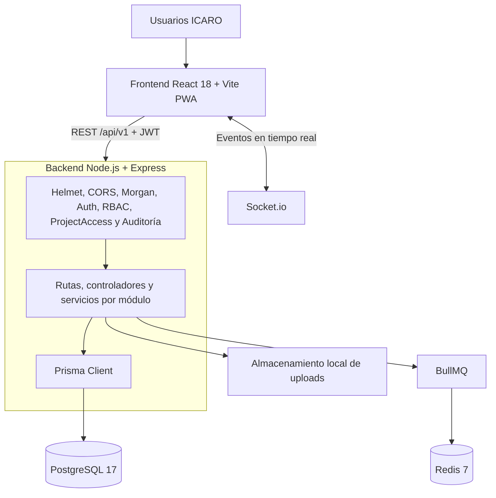
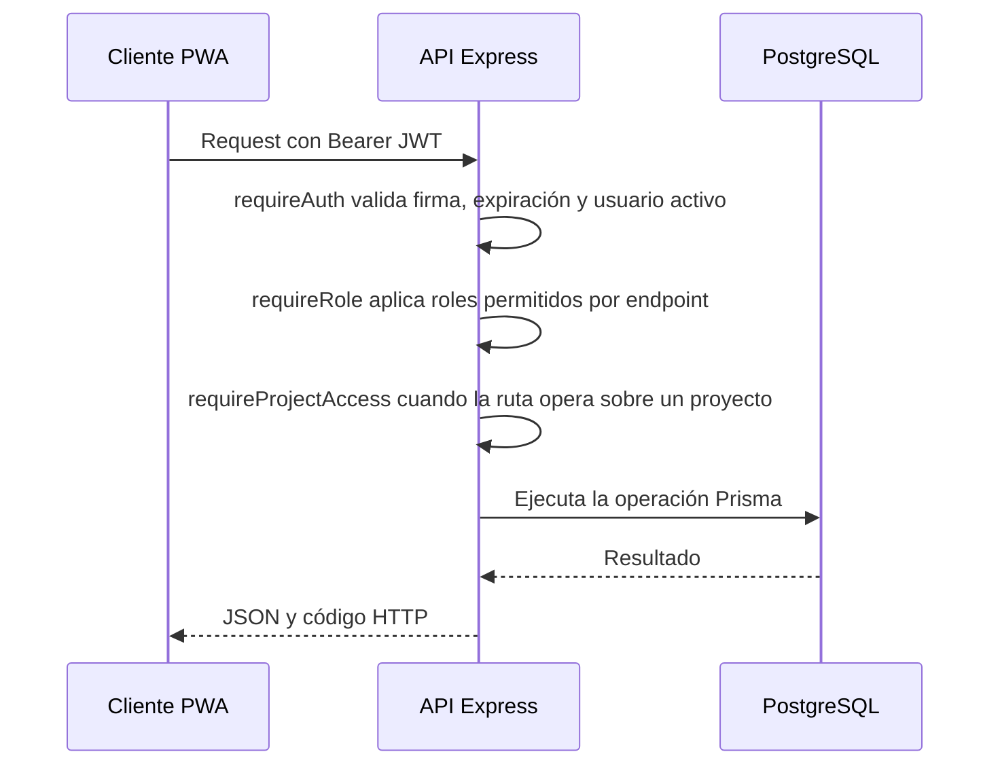

# Diseño Arquitectónico - Sistema ICARO

**Versión:** 2.0 actualizada  
**Estado:** Alineada con la implementación del repositorio al cierre del Sprint 11  
**Fecha de actualización:** 2026-09-09  
**Fuente técnica:** `backend/src/server.js`, `backend/prisma/schema.prisma`, `backend/src/services/`, `frontend/src/db/database.js` y `docker-compose.yml`.

---

## 1. Propósito y alcance

ICARO es un sistema web tipo ERP para la gestión operativa de obras de ICARO CONSTRUCTORES BMGM S.A.S. Centraliza autenticación, proyectos, rubros, avances con evidencia, compras, inventario, consumos, cierres contables, planillas PDF, reportes y trazabilidad.

La solución se implementa como un monolito modular con API REST versionada y un cliente React PWA. La documentación distingue entre funciones ya implementadas, funcionalidades parcialmente integradas y mejoras pendientes; no debe interpretarse que todo componente visible en la interfaz tenga la misma madurez de integración con la API.

## 2. Arquitectura implementada

### 2.1 Capas y responsabilidades

| Capa | Responsabilidad | Estado observado |
|---|---|---|
| Presentación | React, React Router, AuthContext, Axios, vistas y PWA. | Implementada; algunas vistas conservan datos mock o integración parcial. |
| Persistencia local | IndexedDB mediante Dexie para caché, avances y consumos pendientes. | Implementada parcialmente. La BD `icaro_local_v1` define tablas locales de materiales, inventario, movimientos, avances y consumos. |
| API | Express bajo el prefijo `/api/v1`. | Implementada con 15 grupos de rutas montadas. |
| Seguridad transversal | JWT, RBAC, control por proyecto y auditoría de acciones CUD. | Implementada, con reglas de acceso específicas por módulo. |
| Dominio | Controladores y servicios de compras, bodega, consumo, cierre, materiales, órdenes de cambio y reportes. | Implementada en los módulos principales. Algunos endpoints de compatibilidad siguen usando Prisma directamente. |
| Infraestructura | Prisma/PostgreSQL, Redis/BullMQ, Socket.io y sistema local de archivos. | Implementada. |

## 3. Backend y contrato de API

El backend monta las siguientes rutas activas en `server.js`:

| Área | Prefijo | Capacidades principales |
|---|---|---|
| Autenticación | `/api/v1/auth` | Login, recuperación/cambio de contraseña, sesión y logout. |
| Usuarios | `/api/v1/users` | Gestión administrativa de usuarios, roles y estado. |
| Proyectos | `/api/v1/proyectos` | Consulta, creación, edición, cambio de estado y carga masiva de rubros. |
| Materiales | `/api/v1/materiales` | Catálogo CRUD de materiales. |
| Bodega | `/api/v1/bodega` | Recepciones, movimientos e inventario por proyecto. |
| Avances | `/api/v1/avances` | Registro de avance con evidencia cargada y consulta por rubro. |
| Compras | `/api/v1/compras` | Requerimientos, aprobación/rechazo, bandejas y validación contable. |
| Consumo | `/api/v1/consumo` | Material disponible, consumo e historial por proyecto. |
| Cierres | `/api/v1/cierres-contables` | Consolidación, validación, cierre transaccional, hash e historial. |
| Planillas | `/api/v1/planillas` | Solicitud de PDF en cola y consulta de planillas por cierre. |
| Gastos | `/api/v1/gastos` | Registro y consulta de gastos operativos. |
| Órdenes de cambio | `/api/v1/ordenes-cambio` | Validación de excedentes y decisiones de órdenes de cambio. |
| Auditoría | `/api/v1/audit-logs` | Consulta paginada y filtrable del registro de auditoría. |
| Reportes | `/api/v1/reportes` | Dashboard, KPIs y exportación Excel. |
| Pruebas | `/api/v1/test` | Escenarios controlados de seguridad 401/403. |

### 3.1 Seguridad y acceso

El flujo de seguridad real es el siguiente:

Los roles canónicos son: Administrador del Sistema, Presidente / Gerente, Contador, Auxiliar de Contabilidad, Residente y Bodeguero.

`requireProjectAccess` comprueba existencia del proyecto, estado para escrituras y vigencia de asignación para los roles que requieren asignación individual. En la implementación actual Administrador, Presidente/Gerente, Contador, Auxiliar y Bodeguero tienen acceso irrestricto a proyectos; Residente sí requiere una asignación vigente. Por tanto, cualquier cambio futuro que requiera restringir al Bodeguero por proyecto debe modificar el middleware y sus pruebas antes de declararse como regla vigente.

## 4. Persistencia y modelo de datos

Prisma es la fuente de verdad del modelo de datos. El esquema actual contiene 19 modelos:

| Módulo | Modelos |
|---|---|
| Seguridad | `Rol`, `Usuario`, `AsignacionProyectoUsuario` |
| Proyectos y obra | `Proyecto`, `Rubro`, `AvanceObra`, `EvidenciaFotografica` |
| Compras e inventario | `Material`, `RequerimientoCompra`, `DetalleRequerimiento`, `InventarioProyecto`, `MovimientoInventario` |
| Contabilidad | `CierreMensual`, `PlanillaPdf`, `ConsolidacionMensual`, `ValidacionPreCierre` |
| Transversales | `AuditLog`, `OrdenCambio`, `NotificacionSistema` |

La base usa PostgreSQL 17 y el esquema `public` que Prisma mapea mediante `@@map`. `base.sql` histórico no es la fuente de arranque ni de evolución del esquema: las migraciones de Prisma y `schema.prisma` son la referencia de implementación.

## 5. Servicios transversales

| Servicio | Estado y comportamiento real |
|---|---|
| `audit.service.js` + middleware | Registra operaciones CUD de `/api/v1` después de enviar la respuesta. La consulta está disponible en `/api/v1/audit-logs` solo para Admin. La inmutabilidad es una regla de aplicación; no hay evidencia de triggers de BD que bloqueen físicamente `UPDATE` o `DELETE`. |
| `storage.service.js` | Guarda archivos localmente en `backend/uploads`, crea subcarpetas, genera UUID, publica `/uploads/...` y valida imágenes JPG/PNG/JPEG de máximo 5 MB. |
| `queueService.js` | Crea la cola BullMQ `pdf-generation` contra Redis. La ruta de planillas registra la solicitud y responde `202 Accepted`. |
| Worker PDF | Se inicializa desde `server.js` y procesa la generación de planillas. |
| `notification.service.js` | Usa `EventEmitter` y persiste alertas internas y eventos auditables para requerimientos creados, aprobados o rechazados. |
| Socket.io | Se inicializa con el servidor HTTP y emite eventos como cambios de estado de proyecto. |

## 6. Operación offline

El frontend usa Dexie sobre IndexedDB. La base local posee tablas para `materiales_local`, `inventario_local`, `movimientos_inventario_local`, `avances_local` y `consumos_local`; los registros usan estados `pending`, `synced` y `error`. Los consumos incorporan `idempotencyKey` para evitar duplicados al reintentar la sincronización.

La persistencia local y los servicios asociados están presentes. La cobertura funcional debe mantenerse como **parcial** hasta que cada vista de obra e inventario esté conectada y validada mediante pruebas integradas de recuperación de red, conflicto y reintento.

## 7. Despliegue local

`docker-compose.yml` define estos servicios:

| Servicio | Tecnología | Puerto host | Función |
|---|---|---:|---|
| `db` | PostgreSQL 17 | 5433 | Base `Icaro_System`. |
| `redis` | Redis 7 | 6379 | Backend de BullMQ. |
| `backend` | Node.js / Express | 3001 | API REST, Socket.io y worker PDF. |
| `frontend` | React / Vite | 5173 | Cliente PWA de desarrollo. |
| `pgadmin` | pgAdmin 4 | 5050 | Administración local de la base. |

No existe un contenedor NGINX en el Compose actual. Vite puede actuar como proxy de desarrollo, pero NGINX no debe figurar como componente desplegado hasta que sea añadido al archivo de orquestación.

## 8. Criterios de mantenimiento documental

1. Actualizar esta arquitectura junto con cualquier cambio en `server.js`, `schema.prisma`, `docker-compose.yml` o en los contratos de seguridad.
2. Documentar los módulos como implementados solo cuando la ruta, el controlador/servicio y la prueba correspondiente existan en el repositorio.
3. Distinguir los datos mock de la integración real de frontend antes de declarar una historia de usuario completamente entregada.
4. Para reforzar `audit_log`, crear una migración con triggers que impidan `UPDATE` y `DELETE`, y agregar pruebas de integración que prueben esa protección física.