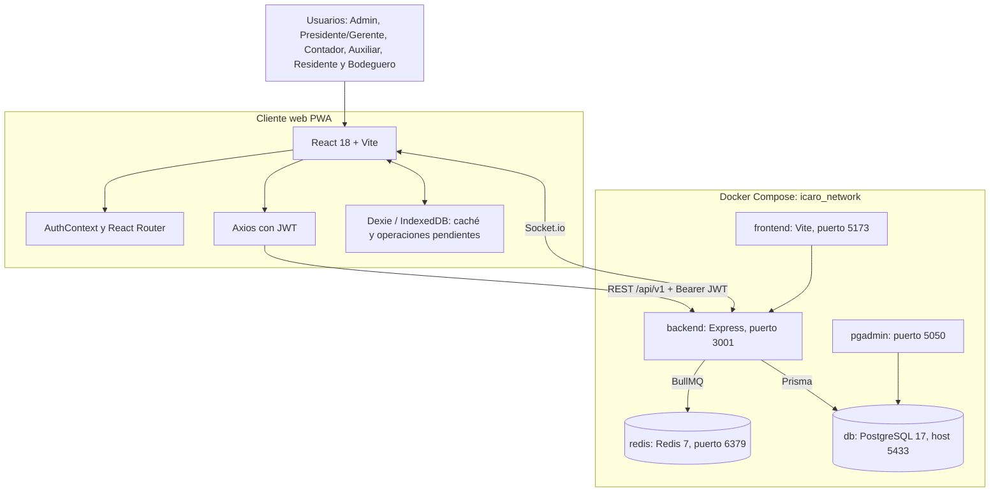
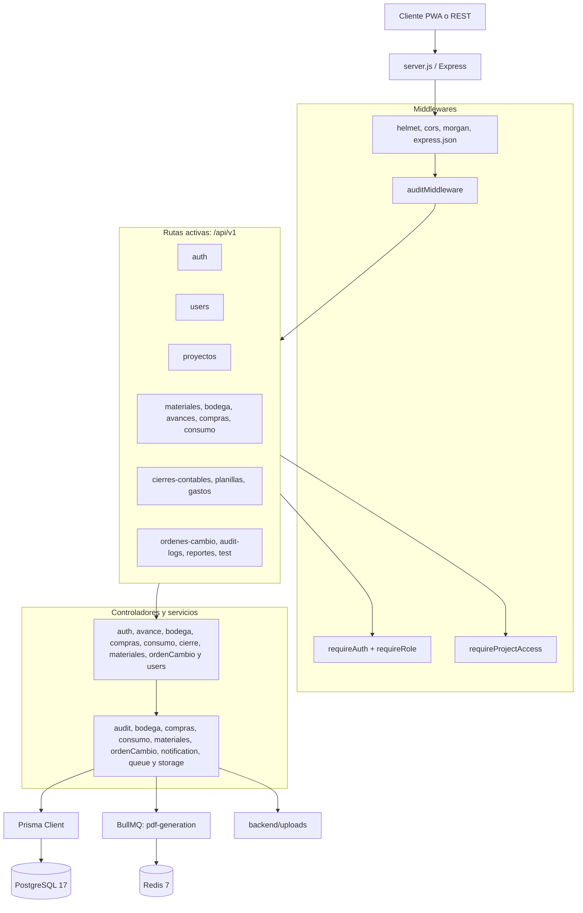
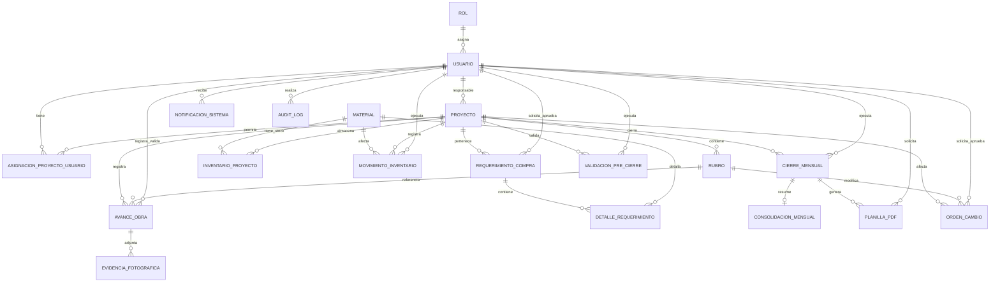
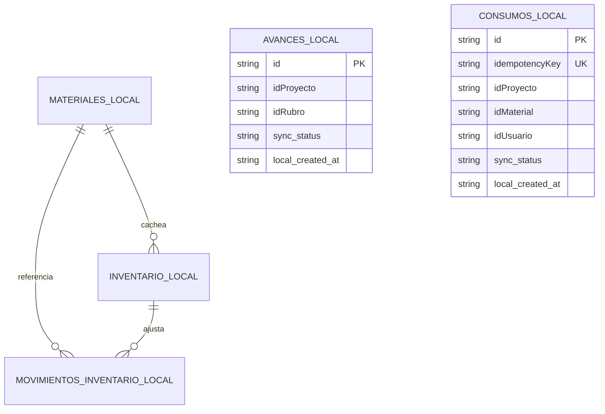
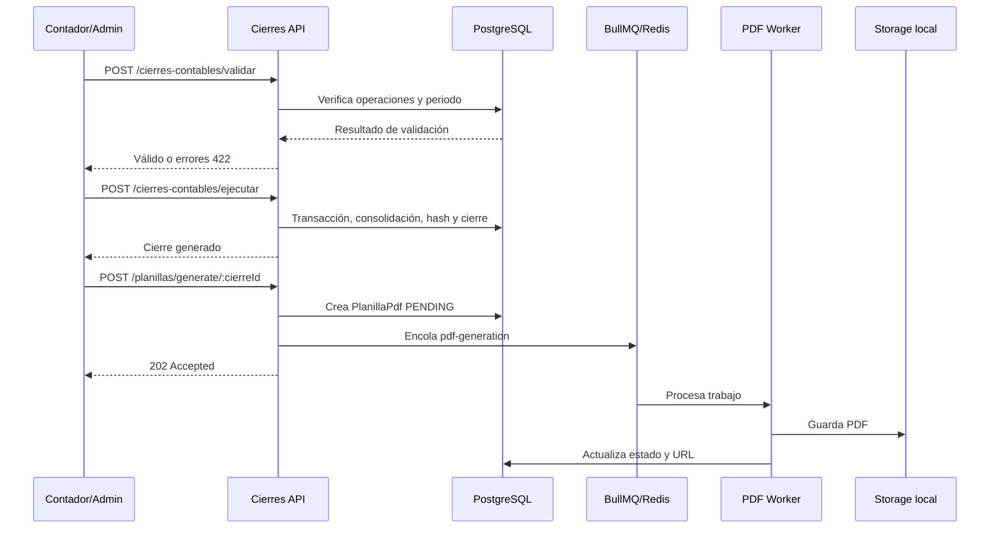

# Diagramas de Arquitectura - Sistema ICARO

**Versión:** 2.0 actualizada  
**Estado:** Alineado con la implementación al cierre del Sprint 11  
**Fecha de actualización:** 2026-09-09

## 1. Arquitectura general

## 2. Componentes backend

## 3. Modelo relacional vigente

## 4. Persistencia local offline

Las tablas locales existen en `frontend/src/db/database.js`. Sus estados son `pending`, `synced` y `error`. La integración offline debe probarse por módulo antes de declararse completamente entregada.

## 5. Flujo de cierre y planilla

## 6. Notas de coherencia

- No se representa NGINX porque no está definido en `docker-compose.yml`.
- Redis no se usa para sesiones: JWT es stateless. Redis respalda la cola BullMQ de planillas.
- La consulta de auditoría existe como `GET /api/v1/audit-logs` y está limitada a Administrador del Sistema.
- La auditoría es append-only por convención de aplicación. Los triggers de base de datos para bloquear modificaciones siguen siendo una mejora pendiente.
- `requireProjectAccess` exige asignación vigente para Residente; los demás roles privilegiados, incluido Bodeguero, tienen acceso irrestricto en la implementación actual.